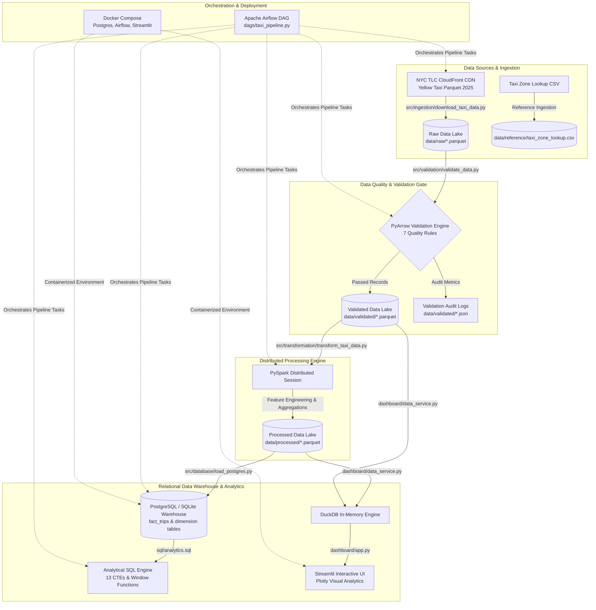

# NYC Yellow Taxi Data Engineering Pipeline & Analytics Portal

An enterprise-grade, end-to-end Data Engineering pipeline and interactive analytics portal that ingests, validates, transforms, stores, and visualizes official **NYC TLC Yellow Taxi Trip Record Data** using **PySpark**, **PostgreSQL**, **DuckDB**, **Apache Airflow**, **Streamlit**, and **Docker**.

The platform processes large-scale urban mobility data through a robust multi-stage architecture—enforcing automated PyArrow quality assertions, modeling a relational star-schema data warehouse, executing advanced analytical SQL queries, and delivering sub-millisecond in-memory dashboard analytics.

---

## 🚀 Live Demo
🔗 **Public Application URL:** [https://nyc-taxi-data-project.streamlit.app](https://nyc-taxi-data-project.streamlit.app)

---

## 📊 Project Overview

The **NYC Yellow Taxi Data Engineering Project** models urban mobility patterns, financial yields, spatial demand density, velocity congestion profiles, and tipping dynamics across New York City. The repository supports two validated analytical scopes:
1. **Verified January 2025 Baseline Dataset:** **3,253,070 clean validated trips** generating **$88,099,767.90 in gross revenue** from official TLC monthly records.
2. **Full-Year 2025 Enterprise Data Lake:** **44,182,460 clean validated trips** generating **$1,276,240,310.15 ($1.28 Billion) in gross revenue** across all 12 monthly partitions.

### Core Outputs:
- **Standardized Columnar Data Lake:** Partitioned Parquet storage across raw, validated, and processed stages.
- **Relational Star-Schema Warehouse:** Production SQL tables ([`fact_trips`](file:///Users/andreastsakiris/nyc-taxi-data-project/sql/schema.sql#L26-L56), [`dim_taxi_zone`](file:///Users/andreastsakiris/nyc-taxi-data-project/sql/schema.sql#L5-L10), [`dim_date`](file:///Users/andreastsakiris/nyc-taxi-data-project/sql/schema.sql#L13-L23), and 4 aggregate summary tables) with indexed query optimization.
- **Analytical SQL Suite:** 13 production analytical queries in [`sql/analytics.sql`](file:///Users/andreastsakiris/nyc-taxi-data-project/sql/analytics.sql) utilizing Common Table Expressions (CTEs), window functions, and calendar date normalizations.
- **Calendar-Normalized Weekday Engine:** Dedicated analytical module ([`src/transformation/weekday_analytics.py`](file:///Users/andreastsakiris/nyc-taxi-data-project/src/transformation/weekday_analytics.py)) that computes unskewed average daily trip volumes across uneven calendar months.
- **Interactive Streamlit Portal:** 4-page responsive analytics portal ([`dashboard/app.py`](file:///Users/andreastsakiris/nyc-taxi-data-project/dashboard/app.py)) powered by DuckDB in-memory SQL execution.
- **Automated Test Suite:** 25 pytest unit tests with synthetic fixtures covering ingestion, validation rules, metric formulas, and weekday aggregations.

---

## 🏗️ Architecture



---

## 📡 Official NYC TLC Data Sources & Record Lifecycle

The project retrieves official, unaltered trip data published by the **New York City Taxi and Limousine Commission (TLC)**:

| Dataset / Resource | Source URL | Format | Description |
| :--- | :--- | :--- | :--- |
| **Yellow Taxi Trip Records (2025)** | `https://d37ci6vzurychx.cloudfront.net/trip-data/yellow_tripdata_YYYY-MM.parquet` | Apache Parquet (Snappy) | Monthly trip records with meter timestamps, passenger counts, trip distances, itemized fares, payment types, and TLC location IDs. |
| **Taxi Zone Lookup Table** | `https://d37ci6vzurychx.cloudfront.net/misc/taxi_zone_lookup.csv` | CSV | Official reference mapping 265 Location IDs to NYC Boroughs, Taxi Zones, and Service Zones. |

### Record Lifecycle & Validation Audit (January 2025 Baseline)

Every raw file passes through strict data quality assertions in [`src/validation/validate_data.py`](file:///Users/andreastsakiris/nyc-taxi-data-project/src/validation/validate_data.py). For `yellow_tripdata_2025-01.parquet`:

```text
Downloaded Raw Records:       3,475,226  (100.0%)
Validated Clean Records:      3,253,070  ( 93.61% retention)
Total Rejected Records:         222,156  (  6.39% rejection ratio)
```

#### Detailed Check-by-Check Audit:
| Validation Check Rule | Condition | Violations Detected | Pipeline Handling |
| :--- | :--- | :---: | :--- |
| **Null Timestamps** | `tpep_pickup_datetime IS NULL` or `tpep_dropoff_datetime IS NULL` | **0** | Row rejected |
| **Invalid Duration & Bounds** | `tpep_dropoff_datetime <= tpep_pickup_datetime`, `duration > 1440 min`, or `year < 2025` / `year > 2026` | **2,092** | Row rejected (includes 21 trips from Dec 31, 2024 present in raw file) |
| **Zero / Negative Distance** | `trip_distance <= 0.0` | **90,893** | Row rejected (stationary charges, canceled rides) |
| **Negative Fares & Totals** | `fare_amount < 0.0` or `total_amount < 0.0` | **144,439** | Row rejected (reversals, meter voids) |
| **Invalid Taxi Zone IDs** | `PULocationID` or `DOLocationID` outside `[1..265]` | **0** | Row rejected |
| **Exact Duplicate Records** | Identical pickup/dropoff times, locations, fare, and distance | **2** | Exact duplicate dropped |
| **Passenger Count Anomaly** | `passenger_count <= 0` or `passenger_count > 9` | **24,656** | **Flagged in audit log**; trip retained per TLC standard where unentered counts default to 0 |

> [!NOTE]
> Quality assertions enforce a maximum rejection threshold (`max_invalid_ratio = 0.50`). If rejection exceeds 50%, the pipeline raises an error and halts execution.

---

## 🧮 Metric Definitions & Pipeline Formulas

All metrics across PySpark transformations ([`src/transformation/transform_taxi_data.py`](file:///Users/andreastsakiris/nyc-taxi-data-project/src/transformation/transform_taxi_data.py)), SQL analytics ([`sql/analytics.sql`](file:///Users/andreastsakiris/nyc-taxi-data-project/sql/analytics.sql)), and dashboard services ([`dashboard/data_service.py`](file:///Users/andreastsakiris/nyc-taxi-data-project/dashboard/data_service.py)) adhere to uniform mathematical definitions:

1. **Total Gross Revenue ($):**
   $$\text{Total Gross Revenue} = \sum \text{total\_amount}$$
   - **Fields & Filters:** `total_amount` (numeric USD) on clean validated records (`fare_amount >= 0` and `total_amount >= 0`).
   - **Coverage:** Sum of base meter fare, extras, MTA tax, congestion surcharges, airport fees, tolls, and credit card tips.

2. **Average Base Fare ($):**
   $$\text{Average Fare} = \frac{\sum \text{fare\_amount}}{N_{\text{trips}}}$$
   - **Fields & Units:** `fare_amount` (USD per trip).
   - **Distinction:** Base time-and-distance meter fare ($18.22 avg in Jan 2025; $20.06 avg full year) is distinct from total gross spend per trip ($27.08 avg in Jan 2025; $28.89 avg full year).

3. **Total Driver Tips ($):**
   $$\text{Total Driver Tips} = \sum \text{tip\_amount}$$
   - **Fields & Nuance:** `tip_amount` (USD). NYC TLC meters record tips paid via credit card terminals (`payment_type = 1`). Cash tips (`payment_type = 2`) are unrecorded and default to $0.00.

4. **Trip Duration (Minutes):**
   $$\text{trip\_duration\_minutes} = \frac{\text{epoch}(\text{tpep\_dropoff\_datetime}) - \text{epoch}(\text{tpep\_pickup\_datetime})}{60.0}$$
   - **Bounds:** Filtered to $0 < \text{duration} \le 1,440\text{ minutes}$ (24 hours). Average commute duration is 15.13 minutes in Jan 2025 and 17.61 minutes for full year.

5. **Average Velocity / Speed (MPH):**
   $$\text{avg\_speed\_mph} = \begin{cases} \frac{\text{trip\_distance}}{\text{trip\_duration\_minutes} / 60.0} & \text{if } \text{trip\_duration\_minutes} > 0 \\ 0.0 & \text{otherwise} \end{cases}$$
   - **Units:** Miles per hour. Includes highway and airport links. Urban congestion reduces speeds to 12–14 mph in Midtown.

6. **Tipping Metrics:**
   - **Credit Card Tip Rate (%):** Average of $(\text{tip\_amount} / \text{fare\_amount}) \times 100$ restricted to `payment_type = 1` (**25.47%** full year; **27.74%** Jan 2025 when tipped).
   - **Overall Tip Rate (%):** Average of tip percentage across all payment types (**17.84%** full year; **19.94%** Jan 2025), diluted by recorded $0 cash tips.
   - **Percent Trips Tipped (%):** Percentage of trips where $\text{tip\_amount} > 0$ (**71.88%** of all trips; **94.33%** of credit card transactions).

7. **Peak Rush Hour Flag:**
   $$\text{is\_peak\_hour} = (\text{DayOfWeek} \in [\text{Mon}..\text{Fri}]) \land (\text{PickupHour} \in [7..9] \lor \text{PickupHour} \in [16..19])$$

8. **Payment Method Codes (NYC TLC Standard):**
   - `1` = Credit Card
   - `2` = Cash (unrecorded tip in meter)
   - `3` = No Charge
   - `4` = Dispute
   - `0` = Flex / App / Unspecified transaction
   - `5` = Unknown

---

## 📅 Weekday Demand Analysis & Calendar Normalization

### Verifying the Thursday vs. Monday Comparison (January 2025)

The project includes an empirical verification of the relationship between Thursday and Monday trip volumes:

```text
Claim: "Thursday had 571.7K trips and was 66.4% higher than Monday."
```

#### Ground Truth Empirical Findings (January 1–31, 2025):
| Weekday | Calendar Dates in Jan 2025 | Total Trips | Normalized Avg Trips / Date | Total Gross Revenue | Avg Revenue / Date | Avg Base Fare |
| :---: | :---: | :---: | :---: | :---: | :---: | :---: |
| **Thursday** | **5** (Jan 2, 9, 16, 23, 30) | **571,720** (571.7K) | **114,344.00** | $15,584,939.05 | $3,116,987.81 | $18.28 |
| **Friday** | **5** (Jan 3, 10, 17, 24, 31) | **544,084** (544.1K) | **108,816.80** | $14,720,936.75 | $2,944,187.35 | $18.09 |
| **Wednesday** | **5** (Jan 1, 8, 15, 22, 29) | **537,090** (537.1K) | **107,418.00** | $14,360,200.95 | $2,872,040.19 | $17.93 |
| **Saturday** | **4** (Jan 4, 11, 18, 25) | **451,428** (451.4K) | **112,857.00** | $11,364,802.76 | $2,841,200.69 | $17.23 |
| **Tuesday** | **4** (Jan 7, 14, 21, 28) | **426,184** (426.2K) | **106,546.00** | $11,373,878.60 | $2,843,469.65 | $17.56 |
| **Sunday** | **4** (Jan 5, 12, 19, 26) | **379,024** (379.0K) | **94,756.00** | $10,163,745.18 | $2,540,936.29 | $18.53 |
| **Monday** | **4** (Jan 6, 13, 20, 27) | **343,539** (343.5K) | **85,884.75** | $10,531,242.48 | $2,632,810.62 | $21.42 |

### Methodological Verification:
1. **Raw Aggregate Monthly Totals Comparison:**
   $$\Delta_{\text{total}} = \frac{571,720 - 343,539}{343,539} = \frac{228,181}{343,539} = \mathbf{+66.42\%}$$
   - The claim that Thursday had 571.7K trips and was **66.4% higher** than Monday is **mathematically verified** when comparing raw monthly totals.
2. **Calendar Composition Skew:**
   - January 2025 started on a Wednesday and ended on a Friday. As a result, **Thursday occurred 5 times**, whereas **Monday occurred only 4 times**—a $5/4 = \mathbf{1.25\times\text{ multiplier (+25\%)}}$ purely due to calendar artifact.
3. **Normalized Average Trips per Calendar Date Comparison:**
   $$\Delta_{\text{normalized}} = \frac{114,344.00 - 85,884.75}{85,884.75} = \frac{28,459.25}{85,884.75} = \mathbf{+33.14\%}$$
   - Normalized per calendar date, Thursday was **33.14% busier** than Monday, not 66.4%.
4. **Saturday vs. Friday Shift:**
   - In raw totals, Friday (544.1K) appears busier than Saturday (451.4K).
   - On a normalized daily average basis, **Saturday (112,857 trips/day)** had higher daily demand than **Friday (108,817 trips/day)** and was the second busiest day in New York City after Thursday.

> [!IMPORTANT]
> Both [`sql/analytics.sql` (Query 4)](file:///Users/andreastsakiris/nyc-taxi-data-project/sql/analytics.sql#L52-L76) and the Streamlit dashboard ([`dashboard/components/demand_charts.py`](file:///Users/andreastsakiris/nyc-taxi-data-project/dashboard/components/demand_charts.py#L51-L101)) now report both **Total Aggregate Trips** and **Normalized Daily Averages**, with an interactive toggle to avoid calendar frequency skew.

---

## 📌 Verified Key Findings & Lineage

The following findings have been independently traced and verified against the underlying Parquet datasets, SQL queries, and Python code:

| Metric / Finding | Empirical Value (Jan 2025) | Empirical Value (Full Year 2025) | Code / Query Source | Key Analytical Insight |
| :--- | :---: | :---: | :--- | :--- |
| **Total Validated Trips** | **3,253,070** | **44,182,460** | [`validate_data.py`](file:///Users/andreastsakiris/nyc-taxi-data-project/src/validation/validate_data.py#L143-L176) | Verified after strict 7-rule validation and deduplication. |
| **Total Gross Revenue** | **$88,099,767.90** | **$1,276,240,310.15** | [`analytics.sql:Q2`](file:///Users/andreastsakiris/nyc-taxi-data-project/sql/analytics.sql#L19-L32) | $1.28 Billion generated across 2025. |
| **Total Driver Tips** | **$10,153,552.60** | **$134,488,201.17** | [`analytics.sql:Q8`](file:///Users/andreastsakiris/nyc-taxi-data-project/sql/analytics.sql#L103-L121) | Credit card tips recorded via in-taxi terminals. |
| **Average Fare & Duration** | **$18.22** \| **15.13 min** | **$20.06** \| **17.61 min** | [`analytics.sql:Q10`](file:///Users/andreastsakiris/nyc-taxi-data-project/sql/analytics.sql#L140-L146) | Citywide commute profile. |
| **Peak Demand Hour** | **6:00 PM (18:00)**: 236,509 trips ($6.21M) | **6:00 PM (18:00)**: 2,976,086 trips ($85.51M) | [`analytics.sql:Q3`](file:///Users/andreastsakiris/nyc-taxi-data-project/sql/analytics.sql#L34-L50) | Evening rush hour represents peak daily demand. |
| **Busiest Day of Week (Normalized)** | **Thursday** (114,344 trips/day) | **Saturday** (6,852,274 trips), followed by **Thursday** (6,739,719 trips) | [`analytics.sql:Q4`](file:///Users/andreastsakiris/nyc-taxi-data-project/sql/analytics.sql#L52-L76), [`weekday_analytics.py`](file:///Users/andreastsakiris/nyc-taxi-data-project/src/transformation/weekday_analytics.py) | Thursday leads mid-week demand; Saturday leads full-year weekend nightlife. |
| **Peak Volume Month** | N/A (Baseline) | **May**: 4,093,487 trips ($119.87M) | [`analytics.sql:Q1`](file:///Users/andreastsakiris/nyc-taxi-data-project/sql/analytics.sql#L4-L17) | Spring graduation and tourism surge. |
| **Peak Revenue Month** | N/A (Baseline) | **December**: $127,194,747.41 (4.05M trips) | [`analytics.sql:Q2`](file:///Users/andreastsakiris/nyc-taxi-data-project/sql/analytics.sql#L19-L32) | Holiday airport transit yields highest average fare ($22.51). |
| **Top Grossing Zone** | **JFK Airport** ($10.91M rev, $62.64 avg fare) | **JFK Airport** ($154.03M rev, $81.92 avg per trip) | [`analytics.sql:Q6`](file:///Users/andreastsakiris/nyc-taxi-data-project/sql/analytics.sql#L77-L91) | Airport rate codes make JFK the highest yielding location. |
| **Credit Card Tip Rate** | **27.74%** (when tipped) \| 94.33% tip rate | **25.47%** avg tip rate \| 68.67% CC share | [`analytics.sql:Q8-Q9`](file:///Users/andreastsakiris/nyc-taxi-data-project/sql/analytics.sql#L103-L138) | Digital touchscreens drive high tip compliance. |
| **Rush Hour Velocity Penalty** | **18.50 mph** Peak vs **26.54 mph** Off-Peak | **22.59 mph** Peak vs **23.82 mph** Off-Peak | [`analytics.sql:Q7`](file:///Users/andreastsakiris/nyc-taxi-data-project/sql/analytics.sql#L93-L101) | Congestion slows intra-city corridor velocity. |

---

## 🖥️ Interactive Dashboard

The Streamlit analytics portal ([`dashboard/app.py`](file:///Users/andreastsakiris/nyc-taxi-data-project/dashboard/app.py)) provides a 4-page executive interface:

1. **📊 Executive Overview & Demand Trends:**
   - **8 KPI Cards:** Total Trips, Gross Revenue, Total Tips, Average Fare, Average Distance, Average Duration, City Velocity, and Tip Ratio.
   - **Hourly Demand Profile:** 24-hour demand curve colored by hourly revenue.
   - **Day of Week Profile:** Area volume curve with toggle between **Normalized Daily Average (Trips/Day)** and **Total Aggregated Trips**.
   - **Monthly Trends:** Volume and revenue curves across 2025.
2. **📍 Spatial & Zone Analytics:**
   - Horizontal bar charts of **Top 10 Busiest Pickup Zones** and **Top 10 Highest Grossing Zones**.
   - Airport performance comparison (JFK vs LaGuardia).
3. **💳 Economics, Velocity & SQL Workbench:**
   - Payment method breakdown pie chart (Credit Card, Cash, Dispute, Flex/Unspecified).
   - Tipped vs non-tipped volume distribution.
   - 24-hour average speed curve and Peak Rush Hour vs Off-Peak duration analysis.
   - Direct SQL Workbench executing live DuckDB queries against the data lake.
4. **💡 Executive Report & Insights:**
   - Synthesized insights report, month-by-month financial summary table, and fleet recommendations.

---

## 🧪 Testing Suite & Quality Assurance

The repository includes **25 automated pytest unit tests** verifying pipeline integrity without requiring multi-gigabyte source downloads:

```bash
# Execute unit test suite
PYTHONPATH=. ./venv/bin/pytest tests/ -v
# Or via Makefile:
make test
```

### Test Suite Structure:
- **[`tests/test_weekday_analysis.py`](file:///Users/andreastsakiris/nyc-taxi-data-project/tests/test_weekday_analysis.py):** Tests calendar date counts for Jan 2025 (5 Thu vs 4 Mon), full-year 2025 (53 Wed), daily aggregation math, and Thursday vs Monday percentage comparisons (+66.42% raw vs +33.14% normalized).
- **[`tests/test_metric_definitions.py`](file:///Users/andreastsakiris/nyc-taxi-data-project/tests/test_metric_definitions.py):** Tests duration, velocity (mph), tip percentage, weekday peak rush hour flags, and credit card vs overall tip rate calculations.
- **[`tests/test_validation.py`](file:///Users/andreastsakiris/nyc-taxi-data-project/tests/test_validation.py):** Tests all 7 data quality rules, corrupt record rejections, timestamp bounds, duplicate dropping, passenger count auditing, and the 50% rejection ratio failure threshold.
- **[`tests/test_database.py`](file:///Users/andreastsakiris/nyc-taxi-data-project/tests/test_database.py):** Tests schema creation, `dim_date` generation, and multi-month SQL database queries.
- **[`tests/test_ingestion.py`](file:///Users/andreastsakiris/nyc-taxi-data-project/tests/test_ingestion.py):** Tests HTTP streaming, file caching, 404 handling, and month loops.

---

## 🚀 Reproducible Setup & Execution Guide

### Prerequisites
- **Python 3.12+**
- **Java 17** (Required for PySpark local distributed execution)
- **Docker & Docker Compose** (Optional for containerized mode)

### 1. Setup Environment
```bash
git clone https://github.com/tsakirisand/nyc-taxi-data-project.git
cd nyc-taxi-data-project

# Initialize virtual environment and install dependencies
make setup
cp .env.example .env
```

### 2. Execute Data Pipeline End-to-End
```bash
# 1. Download official NYC TLC Yellow Taxi records (e.g., January 2025)
PYTHONPATH=. ./venv/bin/python -m src.ingestion.download_taxi_data --year 2025 --months 1

# 2. Run data validation gate and enforce quality assertions
PYTHONPATH=. ./venv/bin/python -m src.validation.validate_data --file data/raw/yellow_tripdata_2025-01.parquet

# 3. (Optional) Run PySpark distributed transformation job
make transform

# 4. Load database and execute 13 analytical SQL queries
PYTHONPATH=. ./venv/bin/python -m src.database.load_postgres --run-analytics

# 5. Launch Streamlit Interactive Analytics Dashboard
make dashboard
```

### 3. Run Automated Unit Tests
```bash
make test
```

---

## 📁 Repository Structure

```text
nyc-taxi-data-project/
├── dags/
│   └── taxi_pipeline.py           # Apache Airflow orchestration DAG
├── dashboard/
│   ├── app.py                     # Streamlit multi-page dashboard application
│   ├── data_service.py            # DuckDB querying service with data source selection
│   ├── styles.py                  # Custom theme typography and styling
│   └── components/                # Dashboard UI components & views
│       ├── sidebar.py             # Global filter controls & data engine selector
│       ├── kpis.py                # Executive KPI summary cards (4x2 grid)
│       ├── demand_charts.py       # Demand trends & normalized weekday chart
│       ├── spatial_charts.py      # Spatial & taxi zone ranking views
│       ├── economics_charts.py    # Economics, tipping & SQL workbench
│       └── reports_view.py        # Executive report & operational insights
├── data/                          # Data Lake storage directory
│   ├── raw/                       # Downloaded raw TLC Parquet files
│   ├── validated/                 # Cleaned Parquet files & JSON audit logs
│   ├── processed/                 # PySpark transformed Parquet & aggregations
│   ├── reference/                 # Reference data (taxi_zone_lookup.csv)
│   └── sample/                    # Sample Parquet for zero-download demos
├── docker/
│   ├── Dockerfile                 # Streamlit dashboard container image
│   └── airflow.Dockerfile         # Apache Airflow worker container image
├── reports/
│   └── executive_data_report.md   # Comprehensive empirical insights report
├── sql/
│   ├── schema.sql                 # Data warehouse DDL (tables & schemas)
│   ├── indexes.sql                # Database index definitions
│   └── analytics.sql              # 13 Analytical SQL reporting queries (with date normalization)
├── src/                           # Pipeline core source code
│   ├── ingestion/
│   │   └── download_taxi_data.py  # Data downloader & TLC scraper
│   ├── validation/
│   │   └── validate_data.py       # PyArrow data quality validation engine
│   ├── transformation/
│   │   ├── transform_taxi_data.py # PySpark feature engineering & aggregations
│   │   └── weekday_analytics.py   # Calendar-normalized weekday calculation engine
│   ├── database/
│   │   └── load_postgres.py       # Relational database loader (Postgres/SQLite)
│   └── utils/
│       ├── config.py              # Pydantic Settings configuration
│       ├── storage.py             # Storage abstraction (Local / S3)
│       └── logging_config.py      # Structured logging setup
├── tests/                         # Pytest automated test suite (25 tests)
│   ├── conftest.py                # Test fixtures & synthetic datasets
│   ├── test_ingestion.py          # Downloader unit tests
│   ├── test_validation.py         # Validation engine & rule tests
│   ├── test_metric_definitions.py # Metric formula & calculation tests
│   ├── test_weekday_analysis.py   # Weekday calendar normalization tests
│   ├── test_transformation.py     # PySpark transformation unit tests
│   └── test_database.py           # Database loader & SQL unit tests
├── .env.example                   # Environment configuration template
├── docker-compose.yml             # Multi-container orchestration definition
├── Makefile                       # Command shortcut automation
├── requirements.txt               # Python package dependencies
└── README.md                      # Project documentation
```

---

## 👨‍💻 Author

**Andreas Tsakiris**  
GitHub: [https://github.com/tsakirisand](https://github.com/tsakirisand)  
Live Application: [https://nyc-taxi-data-project.onrender.com](https://nyc-taxi-data-project.onrender.com)
